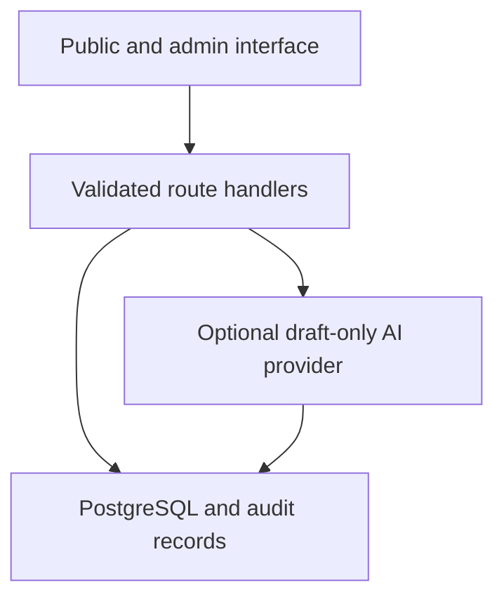

# Architecture and decisions

## Application boundary

A modular monolith: Next.js App Router and React on Node.js 24, strict TypeScript, PostgreSQL 16 and Prisma 6.19.3. One deployable application and one database. Route Handlers call shared validation, authorization and domain services. No microservices, Redis, paid API or billing account is required.

The client uses accessible native controls, Tailwind CSS 4, a Radix Slot/CVA button following shadcn composition patterns, Lucide icons, React Hook Form and Zod. CSS tokens define light/dark colors, spacing and responsive breakpoints. No external font service is contacted.

## Decisions

1. **Preserve the existing work's intent.** GitHub originally contained only a README. The previous `apomatch-source.zip` was inspected: a React/Vite browser-only prototype. Its module names, neutral information principles and green visual direction are retained; browser-only report/task storage is replaced rather than imported as factual data.
2. **PostgreSQL from the outset.** Normalized relationships, foreign keys and versioned migrations. Prisma 6 is pinned because it supports the classic generated client and migration workflow with a small operational surface. An upgrade to Prisma 7 is a separate migration decision.
3. **Explicit editorial publication.** Content starts in review. A different authorized reviewer must verify it. Dependent election content requires a verified source. Source corrections invalidate verification; public election queries require verification within the last 90 days.
4. **No political personalization on the server.** Topic choices stay only in localStorage and never become account, campaign or subscription data. Candidate comparisons describe documented text and order candidates alphabetically. Missing data is explicit.
5. **Organization scopes are enforced in the API.** URL `org` chooses an organization, not a privilege. Every administrative mutation checks membership permissions for that exact organization. Group access additionally requires group membership. Demo organization and city are isolated from the real pilot.
6. **Database sessions.** Passwords use salted scrypt. Opaque random session tokens are only stored as keyed SHA-256 digests. Session expiry is seven days; revocation is immediate on lookup. No JWT refresh architecture is needed for this pilot. Password recovery, email verification and MFA remain launch prerequisites.
7. **Database rate limits.** Atomic upserts function across application replicas. Authentication has account and global caps; write operations have user caps. Edge limits for abusive anonymous reads must be configured at the hosting layer; forwarded IP headers are not blindly trusted.
8. **Maps withheld until boundaries are verified.** No inferred polling places or geographic eligibility. Official maps are linked, with no invented polygons.
9. **AI is optional and cannot publish.** Disabled by default. The Ollama adapter accepts bounded plain text from an editor, not a user-provided fetch URL. Output is stored as a draft with source ID and content digest. Instructions inside documents are untrusted; prompt controls are defense in depth, not a guarantee against injection.
10. **Deployment kept separate.** Docker targets separate app runtime from migration tooling. No server, existing Docker network, proxy, port, database or backup was changed.

11. **Targeted dependency patch.** An npm override pins deepmerge-ts 8.0.0, the patched release for [GHSA-ggr8-5vv4-36mx](https://github.com/advisories/GHSA-ggr8-5vv4-36mx), in Prisma configuration tooling. This avoids changing the Prisma major version solely to resolve that transitive advisory. CLI/schema/migration compatibility and the full CI suite are checked after the override.

## Request lifecycle

Mutation: same-origin check → JSON streaming size bound → Zod validation → session lookup → organization/resource permission → rate limit where applicable → scoped transaction → audit → minimal no-store response. HTML is rendered as text, never through `dangerouslySetInnerHTML`.

## Scaling

Run app replicas behind an HTTPS proxy, with one external PostgreSQL database and a bounded connection pool. Keep migrations a single pre-deployment job. Add a queue only when scheduled delivery/integration volume justifies it. Organization/subscription tables reserve future plans; they do not activate billing or share political profiles.
